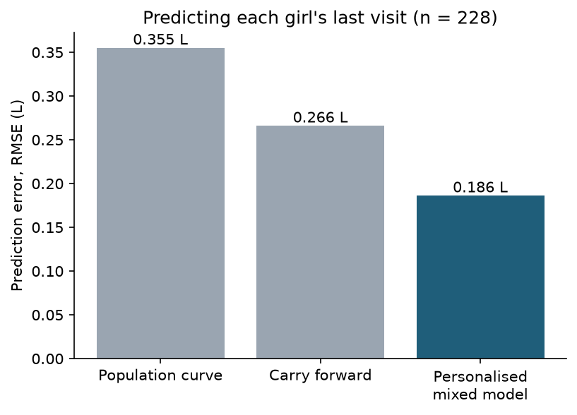
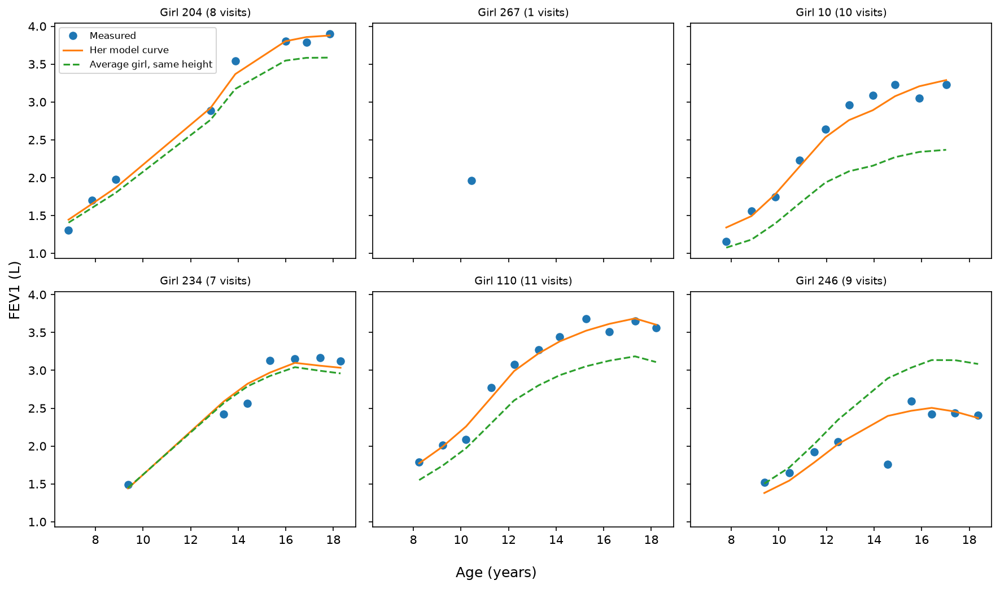
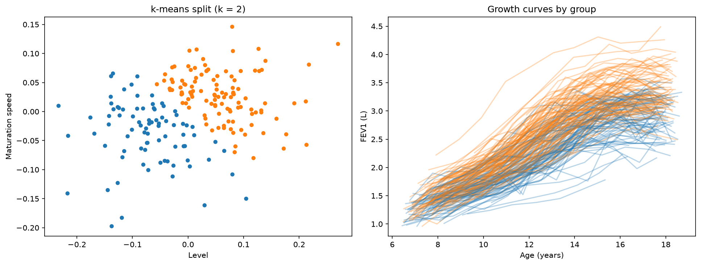

# Childhood lung function trajectories

Modelling, validation and phenotyping of FEV1 growth in a paediatric cohort.

## Objective

A short independent project to practise longitudinal modelling of lung function on public
data, built while preparing my application for a PhD position at the University of Basel.
It covers exploratory analysis, data quality checks, missing-data assessment,
mixed-effects growth models, forward-prediction validation and trajectory phenotyping.

## Key results

- **Final model:** log FEV1 ~ log height + B-spline(age), with a random intercept and a
  random age slope per girl. Both additions clearly improved fit (ΔAIC = 65 and 142).
- **Girls differ consistently:** ICC = 0.73, so most unexplained variation is between
  girls rather than between visits.
- **Personalised predictions work:** predicting each girl's last visit from her earlier
  ones, the mixed model's error (0.186 L) was about 30% lower than carrying forward her
  previous value (0.266 L), and about half that of a population-only curve (0.355 L).
- **No distinct phenotypes:** clustering girls by level and maturation speed gave a
  reproducible split, but no more structure than a single continuous cloud (null
  benchmark). Girls who start lower also grow more slowly and fall further behind.
- **Results are robust** to excluding 17 flagged measurements.



## Data

**Source:** Data courtesy of Dr. Doug Dockery. Six Cities Study of Air Pollution and
Health, lung growth subsample (Topeka, Kansas). Distributed as a teaching dataset with
Fitzmaurice, Laird & Ware, *Applied Longitudinal Analysis* (Wiley).

The raw data file is not included in this repository; download `fev1.dta` from the
book's website and place it in `data/`.

**Population:** 300 girls living in Topeka, with 1994 spirometry measurements between
ages ~6 and ~18 (1–12 visits per girl).

**Format:** long format, one row per girl per visit.

### Data dictionary

| Variable | Type | Unit | Description |
|---|---|---|---|
| `id` | integer | – | Unique child identifier |
| `height` | float | metres | Height at the visit (`ht` in the raw file) |
| `age` | float | years | Age at the visit |
| `init_height` | float | metres | Height at the child's first visit (`baseht`); constant within child |
| `init_age` | float | years | Age at the child's first visit (`baseage`); constant within child |
| `log_fev1` | float | log(litres) | Natural log of FEV1 (`logfev1`) |
| `fev1` | float | litres | **Derived:** `exp(log_fev1)` |
| `suspect` | boolean | – | **Derived:** measurement flagged as questionable (see Data quality) |
| `suspect_reason` | string | – | **Derived:** reason for the flag |

*FEV1 (forced expiratory volume in 1 second) is the volume of air a person can
forcefully exhale in the first second, and is the main measure of lung function
in spirometry.*

### Notes
- The raw file has no variable labels; meanings were inferred from the values and
  the dataset documentation.
- The data contain no empty cells, but visits are irregular (see Missing data).

## 1. Exploration (`notebooks/01_exploration.ipynb`)

**Growth pattern:** FEV1 rises from ~1 L at age 6 to ~3 L at 15, then plateaus. The
timing of the plateau and of growth spurts differs between girls.

**Predictors:** height correlates more strongly with FEV1 than age does (r = 0.91 vs
0.87). On the log–log scale the relationship is linear with even spread:
FEV1 ≈ 0.71 × height^2.90, close to the ~3 expected from volume–length scaling.
Age and height are highly correlated (r = 0.89), but age adds information: a short
older girl has higher FEV1 than younger girls of the same height.

**Data quality:** 17 measurements were flagged rather than deleted:
- 1 implausible value (FEV1 0.50 L at age 9; z = −5.9 relative to girls of similar height);
- 16 "dip-and-recover" visits (≥0.2 L below the previous visit and followed by
  recovery), consistent with poor-effort spirometry (~1% of checkable visits).

A simple height-only z-score wrongly flagged a short 17-year-old with consistently high
FEV1, which showed that age and height need to be modelled jointly.

### Missing data
- Visits were mostly annual (median gap 1.01 years). 91 girls (30%) had at least one
  gap over 2 years, usually a single missed visit; the longest gap was 10 years.
- 48 girls had a single visit. Girls with fewer visits than the median (130) entered
  only slightly older (8.8 vs 8.0 years) but left much earlier (last visit at 11.8 vs
  17.5 years): missingness is mainly **dropout**.
- Restricting to the 155 girls followed to age 17+ changed the mean FEV1 curve by at
  most ~0.05 L, suggesting limited bias from dropout.
- Missingness is assumed **MAR** (explained by observed data), under which mixed models
  using all visits are valid. Dropout related to unobserved lung function (MNAR) cannot
  be excluded.

## 2. Mixed-effects growth models (`notebooks/02_mixed_effects_model.ipynb`)

Models were fitted with `statsmodels` MixedLM (maximum likelihood) on log FEV1, using
all 1994 visits. Log height was centred at 1.5 m and age at 12 years (in decades for the
random slope) to make the intercept interpretable and help convergence.

| Model | Random effects | Age term | AIC |
|---|---|---|---|
| m1 | intercept | linear | −4450.9 |
| m2 | intercept + age slope | linear | −4515.8 |
| **m3 (final)** | intercept + age slope | B-spline (df = 4) | **−4657.8** |

- **m1:** FEV1 scales with height^2.23 and increases ~2.4%/year at fixed height.
  ICC = 0.73.
- **m2:** girls differ in rate of lung maturation (roughly 1.6–3% per year at fixed
  height); level and rate are only weakly correlated (r = 0.17).
- **m3:** the spline captures the plateau in late adolescence. Height coefficient 2.44
  (95% CI 2.26–2.61).
- **Diagnostics:** residuals show no systematic pattern. A longer negative tail is
  consistent with effort-dependent spirometry, where a test can underestimate but not
  overestimate lung capacity.
- **Sensitivity analysis:** excluding the 17 flagged visits changes the height coefficient
  from 2.44 to 2.36 (within the 95% CI); conclusions are unchanged.
- **Convergence:** the random-slope model initially failed to converge; rescaling the
  predictors and using a Powell → L-BFGS optimiser resolved it. Remaining "boundary"
  warnings were checked (both variances clearly > 0, correlation 0.17).



*Dots: measured FEV1. Solid line: the girl's personal model curve. Dashed line: an
average girl of the same height and age. The model follows each girl's level while
ignoring isolated poor-effort tests (girl 246 at age 14.6).*

## 3. Validation (`notebooks/03_validation.ipynb`)

Each girl's last visit was hidden (228 girls with ≥3 visits). The final model was
refitted on the remaining 1766 visits and used to predict the hidden ones.

| Method | RMSE (L) | Bias (L) |
|---|---|---|
| Population curve (fixed effects only) | 0.355 | −0.059 |
| Carry forward (previous value) | 0.266 | −0.076 |
| **Personalised mixed model** | **0.186** | **−0.039** |

- Personalised predictions reduced error by 0.078 L vs carry forward
  (bootstrap 95% CI 0.026–0.148 L, 2000 resamples).
- An error of ~6% is close to visit-to-visit measurement noise (~6%).
- The population curve performed worst: individual level matters more than height and
  age alone. For a new child, predictions improve markedly once repeated measurements
  are available.
- The age spline is defined for ages 6–19; predictions outside this range are not supported.

## 4. Trajectory phenotyping (`notebooks/04_phenotypes.ipynb`)

Each girl's random intercept (**level**) and random age slope (**maturation speed**)
were taken from the final model fitted on all visits, and clustered with k-means.

- Girls with 1–3 visits had speed estimates shrunk to ~0 (too little information), so
  clustering used the 196 girls with ≥5 visits. Both variables were standardised.
- k-means (k = 2–5) gave weak structure: silhouette 0.355–0.390, best at k = 2.
- **Null benchmark:** clustering simulated single-cloud data with the same covariance
  gave silhouette 0.362 on average (95th percentile 0.389). The real data (0.390) is no
  better, so there is **no evidence of distinct trajectory phenotypes**; girls vary along
  a continuum.
- The k = 2 split is nonetheless reproducible (bootstrap ARI 0.94, 5th percentile 0.77)
  and can be used descriptively: "higher and faster" (n = 113; level +0.06, speed +0.03)
  vs "lower and slower" (n = 83; level −0.07, speed −0.04). Visit counts were similar.
- Girls who start lower also mature more slowly, so their FEV1 falls further behind
  during adolescence (tracking with divergence).
- Stability alone does not prove that clusters exist; the null benchmark was needed to
  tell a reproducible split from real groups.



## Limitations
- Girls only, from one US city, measured in the 1970s–80s: results may not generalise
  to boys, current populations, or preterm-born children.
- No information on prematurity, respiratory disease, smoking exposure or environment.
- Missingness is assumed MAR; MNAR dropout cannot be ruled out.
- Validation is internal (same cohort); no external cohort was available.
- Flagging thresholds for "dip-and-recover" visits (0.2 L / 0.3 L) and the ≥5-visit
  threshold for clustering are judgement calls.
- Clustering used shrunken random-effect estimates, which pull girls towards the centre
  and can blur real separation.

## Next steps
- Latent class trajectory models (e.g. `lcmm` in R), which estimate classes inside the
  model rather than clustering shrunken estimates.
- Compare missing-data approaches (complete-case, multiple imputation, mixed model).
- Compare with flexible ML models (e.g. gradient boosting) and interpret with SHAP.
- External validation in an independent cohort, and use of GLI reference z-scores.
- Extension to the questions of the PhD project: trajectories from infancy in
  moderate-to-late preterm children, integrating breath metabolomics, biomarkers and
  environmental exposures, where distinct phenotypes are more plausible.

## Repository structure
```
lung-trajectories/
├── data/                 # not tracked: place fev1.dta here
├── figures/              # figures used in this README
├── notebooks/
│   ├── 01_exploration.ipynb
│   ├── 02_mixed_effects_model.ipynb
│   ├── 03_validation.ipynb
│   └── 04_phenotypes.ipynb
├── src/
├── requirements.txt
└── README.md
```

## How to reproduce
```bash
python -m venv .venv
source .venv/bin/activate
pip install -r requirements.txt
```
Place `fev1.dta` in `data/`, then run the notebooks in order. Notebook 01 creates
`data/fev1_clean.csv`, which the other notebooks use.